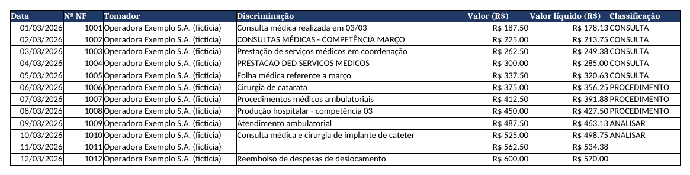
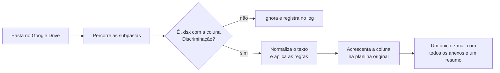

# Classificador de Planilhas

[](https://github.com/Victor-alrib/classificador-planilhas/actions/workflows/ci.yml)

Automação em Python que percorre as pastas de um Google Drive, encontra as planilhas de faturamento, classifica cada registro como **CONSULTA**, **PROCEDIMENTO** ou **ANALISAR** por regras determinísticas e envia todas as planilhas classificadas num único e-mail. Ela roda no Google Colab, sem instalar nada e sem custo.

Desenvolvido num **projeto de extensão do IFSP** para um escritório de contabilidade parceiro, que classificava à mão cerca de 50 planilhas por mês. **A versão 1 foi entregue ao escritório, com manual de uso, e roda na conta Google da própria empresa.**



> **Nenhum dado da empresa parceira está neste repositório.** Todas as planilhas, textos e valores aqui são fictícios, gerados por [`exemplos/gerar_exemplos.py`](exemplos/gerar_exemplos.py).

**Versão atual: 2.** Corrige as falhas que os testes encontraram na versão 1, a que está em uso na empresa: plural, espaços, a palavra "coordenação", a perda de formatação e a senha salva no notebook. A versão 2 ainda precisa ser validada com a empresa. Detalhes em [`CHANGELOG.md`](CHANGELOG.md).

---

## Problema

O escritório recebe, todo mês, cerca de 50 planilhas de faturamento de clínicas e consultórios, com centenas de registros cada. Para cada registro, alguém precisava ler a coluna `Discriminação` e anotar se era consulta ou procedimento, separando os casos duvidosos. O processo era manual e repetitivo, e a alternativa testada antes (colar as planilhas numa IA generativa) dava respostas diferentes para o mesmo texto.

Os requisitos combinados com a empresa foram:

- não alterar nenhum dado da planilha, só acrescentar a coluna `Classificação`;
- seguir **exatamente** as regras do cliente, sem criar categorias novas nem fazer inferências;
- buscar as planilhas no Google Drive e entregar tudo num e-mail específico;
- ser operado por uma pessoa sem conhecimento de programação;
- custo zero.

## Abordagem



### Regras de classificação (definidas pelo cliente)

| Categoria | Quando | Prioridade |
|---|---|---|
| **ANALISAR** | O texto contém `atendimento(s)`, **ou** tem termos de CONSULTA e de PROCEDIMENTO ao mesmo tempo | 1ª |
| **CONSULTA** | Consulta médica, realizadas em coordenação, prestação de serviços médicos, folha médica | 2ª |
| **PROCEDIMENTO** | Procedimento, cirurgia, exame diagnóstico, serviço hospitalar, ambulatório, hospital, produção | 3ª |
| (vazio) | Nenhum termo encontrado; a quantidade aparece no resumo do e-mail | — |

Antes de comparar, o texto e os termos passam pela mesma limpeza: minúsculas, sem acentos, pontuação e espaços repetidos viram um espaço só, e cada palavra vai para o singular. Assim "EXAMES DIAGNÓSTICOS;" e "exame diagnóstico" caem na mesma regra.

### Decisões técnicas e por quê

| Decisão | Por quê |
|---|---|
| Regras fixas em vez de IA generativa | O cliente precisava de resultado **igual toda vez** e auditável: dá para explicar por que cada linha recebeu sua categoria. A IA testada antes respondia diferente ao mesmo texto |
| Limpar texto **e** termos com a mesma função (acentos, pontuação, espaços, plural) | Termos ficam escritos como na regra do cliente, legíveis, e cada um já cobre as variações de escrita |
| Casos ambíguos viram ANALISAR, não um palpite | Melhor mandar para revisão humana do que classificar errado sem avisar |
| Acrescentar a coluna com `openpyxl` **no arquivo original** | Requisito de "estrutura 100 % preservada": abas, fórmulas, estilos e formatos ficam intactos. A v1 regravava pelo pandas e perdia tudo isso |
| Google Colab + `drive.mount()` em vez da API do Google Drive | A API exigiria um projeto no Google Cloud (que pedia cartão e depósito) e credenciais de serviço; o Colab acessa o Drive da própria usuária de graça |
| Gmail via SMTP com senha de app, lida dos *Secrets* do Colab ou digitada na hora | Envio gratuito e autenticado com SSL; a senha nunca fica gravada no notebook |
| Formulário do Colab (`#@param`) | A usuária preenche 3 campos e clica em ▶; não vê nem edita código |
| Filtrar pelo **conteúdo** (presença da coluna `Discriminação`), não pelo nome do arquivo | As pastas reais misturam PDFs, contratos e outras planilhas sem padrão de nome |
| Prefixo `CLASSIFICADO_<subpasta>_` no arquivo gerado | Duas subpastas podem ter um `faturamento.xlsx`; o prefixo evita sobrescrever e mostra a origem |
| Erros por arquivo não interrompem o lote | Uma planilha corrompida não pode impedir o envio das outras 49 |

## Resultados

Medidos rodando **o código do notebook** sobre a pasta de exemplo fictícia. Detalhes em [`resultados/`](resultados/).

- **3 planilhas válidas processadas e 6 itens ignorados corretamente** (PDF, TXT, planilha sem a coluna, arquivo corrompido, subpasta aninhada, arquivo solto na raiz).
- **29 linhas classificadas, todas de acordo com as regras**: 10 CONSULTA, 9 PROCEDIMENTO, 5 ANALISAR e 5 sem categoria.
- **Versão 1 x versão 2 nos mesmos arquivos:** só 7 linhas mudaram, todas pelos motivos previstos (plural, espaços, "coordenação"); as outras 22 saíram iguais.
- **Planilha preservada:** abas, fórmulas, estilos, formatos de data e moeda, painel congelado e filtro iguais ao original. Zero diferenças de estilo célula a célula, contra 48 na versão 1.
- **85 testes automatizados, todos passando.** Eles rodam o código de dentro do notebook, inclusive as três formas de obter a senha.

> Os números acima vêm de dados fictícios e medem se o código faz o que foi especificado. A taxa de acerto e o ganho de tempo com as planilhas reais serão medidos com a empresa; as metas do projeto são ≥ 90 % de acerto e ≥ 70 % de redução de tempo.

## Como rodar

### No Google Colab (como a empresa usa)

1. Envie [`notebook/classificador_planilhas.ipynb`](notebook/classificador_planilhas.ipynb) para o seu Google Drive e abra com **Google Colaboratory**.
2. Crie uma **senha de app** do Gmail em `myaccount.google.com/security` (exige verificação em duas etapas).
3. Opcional: guarde a senha nos *Secrets* do Colab (ícone de chave na barra lateral), com o nome `SENHA_APP` e o acesso do notebook ligado. Sem isso, a senha é pedida a cada execução.
4. Preencha os 3 campos do formulário (pasta, e-mail remetente e e-mail de destino) e execute as duas células.

Passo a passo completo para quem não programa: [`docs/MANUAL_DE_USO.md`](docs/MANUAL_DE_USO.md).

### No seu computador, sem Drive e sem e-mail

Pré-requisito: **Python 3.10+**.

```bash
python -m venv .venv
# Windows (PowerShell):   .venv\Scripts\Activate.ps1
# Linux/macOS:            source .venv/bin/activate
pip install -r requirements-dev.txt

python exemplos/gerar_exemplos.py      # recria a pasta de exemplo fictícia
python executar_local.py               # roda o notebook sobre ela
python -m pytest                       # 85 passed
```

`executar_local.py` executa **o mesmo código** da célula de processamento do notebook. Ele só troca o Google Drive por uma pasta local, simula a senha e, em vez de enviar o e-mail, grava a mensagem em `resultados/email_demo.eml`. Opções: `--entrada` e `--saida` para usar outras pastas, e `--notebook notebook/historico/classificador_planilhas_v1.ipynb` para rodar a versão 1.

### Credenciais

O repositório **não contém e-mails, senhas nem tokens reais**. O formulário só tem valores de exemplo e não tem campo de senha; há testes que garantem as duas coisas. A senha de app fica nos *Secrets* da conta Google da usuária ou é digitada na hora, e nunca deve ser enviada ao GitHub.

## Limitações e próximos passos

**Limitações**

- **A interpretação de "coordenação" precisa ser confirmada com o cliente.** A v2 exige "realizadas em coordenação"; a v1 aceitava a palavra sozinha. Isso muda 2 das 29 linhas de exemplo.
- **"Procedimento" sozinho continua valendo como PROCEDIMENTO**, como na v1. A regra fala em "procedimentos médicos", mas nas planilhas de faturamento a palavra quase sempre se refere a procedimento médico.
- **A passagem para o singular é uma regra simples**, não um dicionário. Ela foi testada com todos os termos das regras, mas plurais irregulares fora deles podem não ser reconhecidos.
- Só a **primeira aba** é classificada; o cabeçalho precisa estar na primeira linha, com a coluna chamada exatamente `Discriminação`.
- Só **um nível de subpastas** é visitado.
- Se a planilha usa uma "Tabela" formatada do Excel, a coluna nova fica fora dela. Gráficos e imagens feitos no Excel passam pelo `openpyxl`, que mantém a maioria dos recursos, mas não todos.
- Os arquivos classificados ficam só na sessão temporária do Colab. Se o envio do e-mail falhar, precisam ser gerados de novo.
- Avaliado automaticamente só com dados fictícios. Nos testes, os *Secrets* e a caixa de senha do Colab são simulados; o teste no Colab real faz parte da validação com a empresa.

**Próximos passos**

- [ ] Validar a versão 2 com a empresa no Colab, em especial a regra de "coordenação" e a leitura da senha pelos *Secrets*
- [ ] Medir acerto e tempo com um lote real, comparado à classificação manual
- [ ] Salvar os arquivos classificados também numa pasta do Drive
- [ ] Gerar um log persistente de cada execução, para auditoria

## Stack

**Linguagem e bibliotecas:** Python, pandas, openpyxl, unicodedata, re, smtplib, getpass, pytest
**Ambiente:** Google Colab (formulário, *Secrets*), Google Drive, Gmail (SMTP com SSL)
**Técnicas:** automação de processos (RPA), classificação baseada em regras, normalização de texto, edição de planilhas preservando formatação, testes do notebook fora do Colab

Documentação técnica: [arquitetura](docs/ARQUITETURA.md) · [manual de uso](docs/MANUAL_DE_USO.md) · [exemplos](exemplos/README.md) · [histórico de versões](CHANGELOG.md)

## Autoria

Projeto de extensão do IFSP. A primeira versão do motor de classificação foi escrita por um colega da equipe. **Victor** (Engenharia de Controle e Automação) levou a demanda do escritório para o projeto, definiu os requisitos da automação, testou no Colab e entregou o programa e o manual à usuária, e desenvolveu a versão 2, com auxílio de IA (Claude) na escrita do código, dos testes e da documentação.

## Licença

[MIT](LICENSE). Projeto acadêmico de extensão; as regras de classificação refletem a necessidade de um cliente específico.
