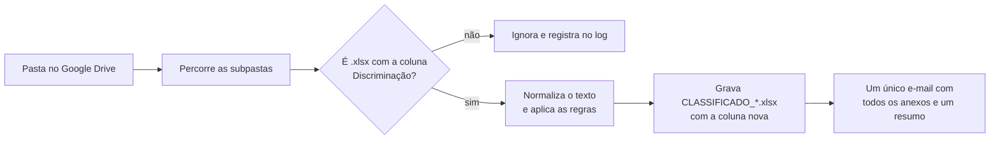

# Classificador de Planilhas

[](https://github.com/Victor-alrib/classificador-planilhas/actions/workflows/ci.yml)

Automação em Python que percorre as pastas de um Google Drive, encontra as planilhas de faturamento, classifica cada registro como **CONSULTA**, **PROCEDIMENTO** ou **ANALISAR** por regras determinísticas e envia todas as planilhas classificadas num único e-mail. Ela roda no Google Colab, sem instalar nada e sem custo.

Desenvolvido num **projeto de extensão do IFSP** para um escritório de contabilidade parceiro, que classificava à mão cerca de 50 planilhas por mês. **A automação foi entregue ao escritório, com manual de uso, e roda na conta Google da própria empresa.**


> **Nenhum dado da empresa parceira está neste repositório.** Todas as planilhas, textos e valores aqui são fictícios, gerados por [`exemplos/gerar_exemplos.py`](exemplos/gerar_exemplos.py). As cores da imagem acima foram aplicadas só na captura.

---

## Problema

O escritório recebe, todo mês, cerca de 50 planilhas de faturamento de clínicas e consultórios, com centenas de registros cada. Para cada registro, alguém precisava ler a coluna `Discriminação` e anotar se era consulta ou procedimento, separando os casos duvidosos. O processo era manual e repetitivo, e a alternativa testada antes (colar as planilhas numa IA generativa) dava respostas diferentes para o mesmo texto.

Os requisitos combinados com a empresa foram:

- não alterar nenhum dado da planilha, só acrescentar a coluna `Classificação`;
- seguir **exatamente** as regras do cliente, sem criar categorias novas nem fazer inferências;
- buscar as planilhas no Google Drive e entregar tudo num e-mail específico;
- ser operado por uma pessoa sem conhecimento de programação;
- custo zero.

## Abordagem



### Regras de classificação (definidas pelo cliente)

| Categoria | Quando | Prioridade |
|---|---|---|
| **ANALISAR** | O texto contém `atendimento(s)`, **ou** tem termos de CONSULTA e de PROCEDIMENTO ao mesmo tempo | 1ª |
| **CONSULTA** | Consulta médica, consultas médicas, coordenação, prestação de serviços médicos, folha médica | 2ª |
| **PROCEDIMENTO** | Procedimento, cirurgia, exame diagnóstico, serviço hospitalar, ambulatório, hospital, produção | 3ª |
| (vazio) | Nenhum termo encontrado; a quantidade aparece no resumo do e-mail | — |

### Decisões técnicas e por quê

| Decisão | Por quê |
|---|---|
| Regras fixas em vez de IA generativa | O cliente precisava de resultado **igual toda vez** e auditável: dá para explicar por que cada linha recebeu sua categoria. A IA testada antes respondia diferente ao mesmo texto |
| Normalizar o texto antes de comparar (minúsculas, sem acentos via `unicodedata.normalize('NFKD')`) | "CONSULTA MÉDICA", "consulta medica" e "Consulta Médica" precisam cair na mesma regra |
| Casos ambíguos viram ANALISAR, não um palpite | Melhor mandar para revisão humana do que classificar errado sem avisar |
| Google Colab + `drive.mount()` em vez da API do Google Drive | A API exigiria um projeto no Google Cloud (que pedia cartão e depósito) e credenciais de serviço; o Colab acessa o Drive da própria usuária de graça |
| Gmail via SMTP com senha de app | Envio gratuito, sem serviço externo, autenticado com SSL na porta 465 |
| Formulário do Colab (`#@param`) | A usuária preenche 4 campos e clica em ▶; não vê nem edita código |
| Filtrar pelo **conteúdo** (presença da coluna `Discriminação`), não pelo nome do arquivo | As pastas reais misturam PDFs, contratos e outras planilhas sem padrão de nome |
| Prefixo `CLASSIFICADO_<subpasta>_` no arquivo gerado | Duas subpastas podem ter um `faturamento.xlsx`; o prefixo evita sobrescrever e mostra a origem |
| Erros por arquivo não interrompem o lote | Uma planilha corrompida não pode impedir o envio das outras 49 |

## Resultados

Medidos rodando **o código do notebook entregue** sobre a pasta de exemplo fictícia. Detalhes em [`resultados/`](resultados/).

- **3 planilhas válidas processadas e 6 itens ignorados corretamente** (PDF, TXT, planilha sem a coluna, arquivo corrompido, subpasta aninhada, arquivo solto na raiz).
- **26 linhas classificadas**, todas iguais ao esperado para o código atual: 9 CONSULTA, 7 PROCEDIMENTO, 4 ANALISAR e 6 sem categoria.
- Das 6 sem categoria, **3 são limitações reais** diante da regra do cliente (ver abaixo).
- **Dados originais intactos** célula a célula; nome da aba e larguras de coluna preservados.
- **47 testes automatizados**: 44 passando e 3 falhas esperadas (`xfail`) que documentam as limitações.

> Os números acima vêm de dados fictícios e medem se o código faz o que foi especificado. A taxa de acerto e o ganho de tempo com as planilhas reais serão medidos com a empresa; as metas do projeto são ≥ 90 % de acerto e ≥ 70 % de redução de tempo.

## Como rodar

### No Google Colab (como a empresa usa)

1. Envie [`notebook/classificador_planilhas.ipynb`](notebook/classificador_planilhas.ipynb) para o seu Google Drive e abra com **Google Colaboratory**.
2. Crie uma **senha de app** do Gmail em `myaccount.google.com/security` (exige verificação em duas etapas).
3. Preencha os 4 campos do formulário (pasta, e-mail remetente, senha de app, e-mail de destino) e execute as duas células.

Passo a passo completo para quem não programa: [`docs/MANUAL_DE_USO.md`](docs/MANUAL_DE_USO.md).

### No seu computador, sem Drive e sem e-mail

Pré-requisito: **Python 3.10+**.

```bash
python -m venv .venv
# Windows (PowerShell):   .venv\Scripts\Activate.ps1
# Linux/macOS:            source .venv/bin/activate
pip install -r requirements-dev.txt

python exemplos/gerar_exemplos.py      # recria a pasta de exemplo fictícia
python executar_local.py               # roda o notebook sobre ela
python -m pytest                       # 44 passed, 3 xfailed
```

`executar_local.py` executa **o mesmo código** da célula de processamento do notebook. Ele só troca o Google Drive por uma pasta local e, em vez de enviar o e-mail, grava a mensagem em `resultados/email_demo.eml`. Para usar outra pasta: `python executar_local.py --entrada CAMINHO --saida CAMINHO`.

### Credenciais

O repositório **não contém e-mails, senhas nem tokens reais**: os campos do formulário trazem só valores de exemplo, e há um teste que garante isso. A senha de app é digitada pela própria usuária, na conta Google dela, e nunca deve ser enviada ao GitHub.

## Limitações e próximos passos

**Limitações (todas reproduzidas na pasta de exemplo e cobertas por testes)**

- **"Exames diagnósticos" no plural não é reconhecido.** A busca é por trecho exato e a lista tem só o singular `exame diagnostico`. "Serviços hospitalares" só funciona porque também contém `hospital`.
- **Espaço duplo ou quebra de linha** dentro da célula impedem a correspondência.
- **"Coordenação" sozinha vira CONSULTA**, mesmo em "coordenação administrativa"; a regra do cliente fala em "consultas médicas realizadas em coordenação".
- **A formatação não é preservada por completo.** Ficam os dados, o nome da aba e as larguras. Perdem-se as outras abas, o estilo do cabeçalho, o painel congelado e os formatos de data e moeda, porque o arquivo é regravado pelo pandas.
- Só **um nível de subpastas** é visitado, e a coluna precisa se chamar exatamente `Discriminação` na primeira linha.
- A senha de app digitada no formulário **fica salva no notebook** quando o Colab salva o arquivo.
- Os arquivos classificados ficam só na sessão temporária do Colab. Se o envio do e-mail falhar, precisam ser gerados de novo.
- Avaliado automaticamente só com dados fictícios; a taxa de acerto com dados reais é o próximo passo com a empresa.

**Próximos passos**

- [ ] Normalizar espaços e aceitar plurais (ou comparar por palavras em vez de trecho)
- [ ] Escrever a coluna nova direto com `openpyxl` no arquivo original, preservando formatação e outras abas
- [ ] Ler a senha pelos *Secrets* do Colab (`google.colab.userdata`) em vez do formulário
- [ ] Salvar os arquivos classificados também numa pasta do Drive
- [ ] Medir acerto e tempo com um lote real, comparado à classificação manual
- [ ] Gerar um log persistente de cada execução, para auditoria

## Stack

**Linguagem e bibliotecas:** Python, pandas, openpyxl, unicodedata, smtplib, pytest
**Ambiente:** Google Colab, Google Drive, Gmail (SMTP com SSL)
**Técnicas:** automação de processos (RPA), classificação baseada em regras, normalização de texto, ETL de planilhas, testes do notebook fora do Colab

Documentação técnica: [arquitetura](docs/ARQUITETURA.md) · [manual de uso](docs/MANUAL_DE_USO.md) · [exemplos](exemplos/README.md)

## Autoria

Projeto de extensão do IFSP. A primeira versão do motor de classificação foi escrita por um colega da equipe. **Victor** (Engenharia de Controle e Automação) levou a demanda do escritório para o projeto, definiu os requisitos da automação, testou no Colab e entregou o programa e o manual à usuária, com auxílio de IA (Claude) na escrita do código, dos testes e da documentação.

## Licença

[MIT](LICENSE). Projeto acadêmico de extensão; as regras de classificação refletem a necessidade de um cliente específico.
